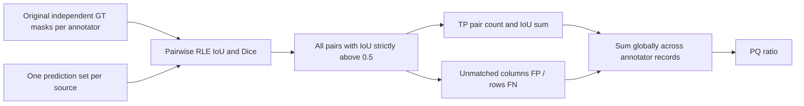

# Official evaluator semantics and error analysis

The local parent `self-evaluation-notebook.ipynb` is the primary scoring reference.
Its helpers `get_overlap_matrices`, `get_overlap_df`, `get_pq_score`, FP/FN counting,
RLE decoding and grouping are extracted unchanged in `tests/reference_official.py`.
Production code reproduces their behavior using memory-efficient COCO RLE overlaps.

For an annotator-image record, pairwise overlap is a matrix with ground-truth
instances as rows and predictions as columns:

\[
I_{ij}=\frac{|G_i\cap P_j|}{|G_i|+|P_j|-|G_i\cap P_j|},\qquad
D_{ij}=\frac{2I_{ij}}{1+I_{ij}}.
\]

`pycocotools.mask.iou` receives independent encoded binary masks with all crowd
flags zero. This avoids allocating dense float32 stacks and matrix multiplication
over every native pixel, and avoids uint8 matrix-product overflow.

**Matching is strictly `IoU > 0.5`.** The official notebook counts every qualifying
pair, with no Hungarian or greedy one-to-one assignment. FP counts prediction
columns without any hit; FN counts GT rows without any hit. If two overlapping GT
masks both match a prediction, both pairs contribute TP and IoU. This is a crucial
difference from implementations that assume all ground truth is disjoint.

Across records, sum TP, FP, FN and matched IoUs first:

\[
PQ=\frac{\sum I_{ij}\mathbf{1}[I_{ij}>0.5]}
{TP+\frac12FP+\frac12FN}.
\]

An empty denominator gives zero. This is a global count-weighted score, not a mean
of per-image PQ. The same source prediction set is evaluated separately against
each annotator record. CSV compatibility groups GT by `<annotator>-<source>` and
predictions by `<source>` before suffixes; the internal record interface avoids
depending on parsing for normal validation.

## Additional reports

`evaluate_panoptic_quality` returns counts, score, matched IoUs, all positive-pair
Dice/IoU values, overlap matrices, instance counts and degree lists. These are
saved for best/worst images and error galleries. The positive-pair distribution is
different from the matched-pair mean used to describe segmentation quality.

`analyze_fragmentation` counts GT rows overlapping more than one prediction at
**IoU > 0**, matching the reference relation plot. `analyze_overmerging` similarly
counts prediction columns overlapping more than one GT. Tiny incidental overlap
counts toward degree, so these are diagnostic relations, not matching TPs. False
positives/misses instead use the official >0.5 criterion.

Training validation includes native model time in epoch duration and records
postprocessing/evaluation time by record. Cached validation records model inference
time per source and postprocessing time; cache hits report model time as null,
because a cache read must not be misreported as a new forward pass. Multiple
annotator records can share the same source-time measurement.

## Parity tests and explicit differences

Synthetic comparisons cover identical masks, touching objects, one disconnected
GT instance, overlapping GT masks that both match one prediction, exact 0.5 IoU,
no GT, no predictions, both empty, multi-annotator grouping and global aggregation.
Matrices and final scores are compared to the extracted original functions, not
only to handwritten expected constants.

The production record API includes explicitly empty annotation records; an
instance-only GT CSV cannot represent them, so the official CSV helper only sees
annotator-image groups present in rows. Empty records are not silently dropped
from internal evaluation. Sources absent from the supplied GT CSV are likewise
not evaluated by its compatibility helper; normal validation uses its explicit
split inventory. Category/crowd scoring is not invented; crowd input is rejected
because this competition pipeline treats all supplied filaments as one class.

RLE arithmetic is float64 while the reference Torch matrix calculation is
float32; threshold behavior is exact around 0.5 for integer pixel areas, with
ordinary floating-point differences elsewhere. Cached search probabilities are
float16 to limit disk use, and test postprocessing uses the same float16
quantization. Training PQ is calculated directly from FP32 probabilities. This can
affect borderline threshold pixels, so compare precisions if final experiments
show sensitive behavior.

The default split excludes multiply annotated sources from validation to preserve
the prior protocol. Evaluation itself fully supports them. For a more representative
estimate set `multi_annotator_train_only=False` in a new output directory and
compare with a source-grouped holdout. Selection on both checkpoint and threshold
using the same validation set introduces bias; use an untouched holdout or nested
grouped cross-validation when reporting final performance.

See the [organizer notebook](https://www.kaggle.com/code/azimahmadzadeh/self-evaluation-notebook)
and the local extracted fixture for the exact reference behavior. The challenge
[submission specification](https://www.kaggle.com/competitions/filament-segmentation-2026/overview/final-submission)
defines the counts-only RLE CSV; the supplied notebook resolves scoring behavior
where historical overview wording differs.
