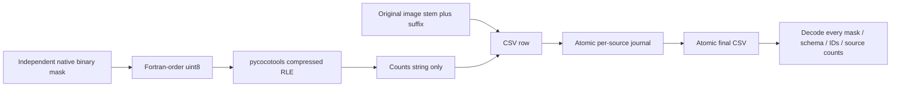

# Function reference

All paths below are relative to `custom-Unet`. Production tensors use native
H=W=2048. Synthetic tests may call low-level APIs with smaller sizes; `Config`
rejects changing the production resolution. Python paths accept strings or Paths
unless specified. NumPy masks are HW booleans; model/loss maps are Torch tensors.

## Configuration and atomic artifacts

| Function/class | Inputs | Outputs and behavior |
|---|---|---|
| `Config` | Central serializable dataclass fields | Paths, split policy, architecture/loss, augmentation, training, probes, postprocessing. |
| `Config.validate()` | Configuration instance | Same validated object; useful exception for unsupported production settings. |
| `Config.to_dict()` | Configuration instance | JSON-compatible dict. |
| `atomic_json(path,value)` | JSON-safe data, output path | Atomically replaces JSON; refuses NaN/infinity. |
| `fingerprint(value)` | JSON-serializable value | Stable sorted-key SHA-256. |
| `file_hash(path)` | Existing binary file | Streaming SHA-256 for checkpoint/image provenance. |

## Discovery, splitting and preparation (`filament.data`, `workflow`)

Raw records contain image ID, original filename/path, native height/width, decoded
pixel hash, original annotation IDs, and annotation dictionaries. Cached records
replace large annotation payloads with `target_path`, `instances_path`, and
`target_fingerprint`. The instance JSON preserves original COCO payloads/IDs.

| Function/class | Inputs | Outputs and behavior |
|---|---|---|
| `find_dataset_root(override='')` | Optional MAGFiLO root | Validated absolute Path; searches ancestors and `/kaggle/input`. |
| `make_records(root,expected_size=2048,hash_images=True)` | MAGFiLO layout | `(raw_records, integrity_report)`; checks unique IDs, references, native image dimensions, pixel duplicates and annotator counts. |
| `discover_test_images(root,expected_size=2048)` | Test image directory | Sorted Paths; unique stems and dimensions checked, no test labels read. |
| `read_grayscale(path,expected_shape=None)` | Native grayscale file | uint8 HW; raises on unreadable/dimension mismatch. |
| `group_annotations_by_source(records)` | Raw or cached records | Dict original filename → annotator records. |
| `create_train_val_split(records,val_fraction,seed,multi_annotator_train_only)` | Source/duplicate groups | ID manifest; deterministic validation of eligible sources, no filename/pixel leakage. |
| `verify_no_leakage(train,val)` | Nonempty record lists | Raises if image ID, filename or pixel hash crosses partitions. |
| `record_fingerprint(records)` | Source/annotation identity fields | Stable dataset identity for split reuse. |
| `save_split_manifest(path,manifest)` | Split dict | Atomic manifest write. |
| `load_split_manifest(path,records)` | Current records | Verified ID manifest; rejects changed inventory or duplicate membership. |
| `summarize_dataset(records,small_area=20)` | Raw records, native pixel threshold | `(summary, per_record_rows)` including independent instance areas, foreground/overlap and small instances. Streams one record at a time. |
| `cache_training_targets(records,cache_dir,radius=1,centerline=False)` | Raw records, target options | Light cached records; content/version-bound NPZ and original-instance JSON. |
| `cached_instances(cached_record)` | Cached original-instance JSON path | List of original independent boolean masks for one annotator record. |
| `normalize_image(image,mode='unit')` | uint8 HW, unit/robust mode | float32 HW in [0,1]; no spatial resampling. |
| `augment_sample(image,targets,rng,options)` | Float HW and aligned target dict | Transformed image/targets; image-only photometric changes. |
| `FullImageDataset(records,augment,seed,normalization,augment_options)` | Cached records | Lazy `image`, `foreground`, `separation`, `separation_valid` CHW tensors and integer index. |
| `FullImageDataset.set_epoch(epoch)` | Epoch integer | Updates shared augmentation epoch for workers. |
| `seed_loader_worker(worker_id)` | Worker index from DataLoader | Limits OpenCV/Torch CPU threads per worker. |
| `prepare_experiment(config,statistics=True)` | Valid production Config | Runtime dict with cached train/validation records, config and content/split fingerprint; saves preparation artifacts. Smoke limits cached records, never resolution. |
| `launch_training(runtime,num_gpus=None)` | Prepared runtime and GPU count | Executes generated worker, streams logs; retries whole job after recoverable OOM. |

## Target construction (`filament.targets`)

| Function | Inputs | Outputs and behavior |
|---|---|---|
| `decode_annotation_mask(annotation,height,width)` | One COCO polygon/RLE annotation | One independent bool HW mask; multipart regions stay one instance. Invalid/empty individual annotations raise. |
| `load_image_instances(record)` | One raw annotator record | One mask per annotation in original order. No connected-component reconstruction. |
| `build_foreground_mask(instances,shape)` | Independent masks and HW | Union bool HW; empty list yields zeros. |
| `build_instance_id_map(instances,shape)` | Original order and shape | int32 HW: 0 background, 1-based ordinal, -1 overlap. |
| `build_boundary_target(instances,shape,radius=1)` | Independent masks and native radius | `(separation, valid)` boolean HW maps, based on distinct-instance 8-connected proximity and excluded overlap neighborhoods. |
| `build_centerline_target(instances,shape)` | Independent masks | Union of per-instance hard skeletons; optional cache/inspection feature. |
| `validate_targets(targets,instances)` | Aligned maps and original masks | Checks shape, foreground union, IDs and separation/exclusion consistency. |
| `build_targets(record,radius,centerline)` | Raw record | Validated dict with foreground, instance_ids, separation, separation_valid, optional centerline. |

## Models and losses (`unet.py`, `filament.model`, `filament.losses`)

| Function/class | Inputs | Outputs and behavior |
|---|---|---|
| `DoubleConv(in_channels,out_channels,normalization,activation)` | BCHW | Two 3×3 conv/norm/activation stages; unchanged spatial dimensions. |
| `ModifiedUNet(in_channels=1,out_channels=2,init_features=16,normalization='group',activation='relu',checkpoint_blocks=True)` | BCHW with H,W ≥16 | Raw B×out_channels×H×W logits; saved four-pool U-Net structure. |
| `_match_and_concat(upsampled,bypass)` | Decoder/encoder tensors | Aligned channel concatenation using padding for pooling-rounding differences. |
| `build_model(config_dict)` | `name='modified'` or `'full_image'` and matching constructor options | One consistent logits model; default is saved ModifiedUNet. |
| `FullImageUNet` (`experimental`) | Input/output channels, base width/depth/cap/checkpoint option | Previous deeper GroupNorm/global-context model, opt-in only. |
| `FilamentPQProxyLoss(**loss_options)(logits,targets)` | B2HW logits plus foreground/separation/valid B1HW | Dict differentiable `loss`, detached BCE/Dice/boundary/clDice. Legacy BHW IDs also supported with documented limitations. |
| `instance_boundaries(instance_ids)` | Legacy BHW IDs | B1HW direct distinct-positive contacts; excludes exterior boundaries. |
| `soft_erode(x)` | B1HW probability | Soft erosion by min-pooling approximations. |
| `soft_open(x)` | B1HW probability | Soft erosion then dilation. |
| `soft_skeleton(x,iterations=5)` | B1HW probability | Differentiable soft skeleton, graph grows with iterations. |
| `soft_cldice_loss(probabilities,targets,iterations)` | B1HW prediction/union target | Mean soft topology surrogate; disabled by default in composite loss. |

## Training and checkpoint state (`filament.training`)

| Function | Inputs | Outputs and behavior |
|---|---|---|
| `seed_everything(seed,deterministic=True)` | Integer seed | Seeds Python/NumPy/Torch/CUDA and deterministic preferences. |
| `rng_state()` / `restore_rng(state)` | Current process / saved state | Capture or restore Python, NumPy, CPU Torch and rank-local CUDA RNG. |
| `gpu_statistics(device)` | Torch device | Allocated/reserved/peak GiB; optional utilization point sample. |
| `probe_batch_sizes(model,criterion,sample,config,device)` | Unwrapped CUDA model, actual CHW sample | `(selected_batch_or_None, per_rank_reports)`; real accumulated backward and Adam slots; restores weights/RNG. |
| `run_epoch(model,loader,criterion,device,optimizer=None,...)` | Collated batch dict, optional optimizer/scaler, accumulation and AMP options | `(metrics, PQ_record_details)`; no optimizer means validation; supports DDP and disjoint unequal validation lengths. |
| `train_one_epoch(model,loader,criterion,optimizer,scaler,device,...)` | Training objects | Sample-weighted loss/time metrics; correct incomplete windows. |
| `validate_one_epoch(model,loader,criterion,device,pq_records=None,...)` | Validation loader, optional original records | `(metrics, details)`; inference mode, no optimizer step. |
| `update_early_stopping(state,pq,patience,delta=1e-6)` | PQ evaluation history | `(new_state, improved, should_stop)`; patience counts PQ evaluations. |
| `save_checkpoint(path,model,optimizer,scheduler,scaler,epoch,best_metrics,config,early_stopping,history,rank_rng_states,split_fingerprint)` | Complete epoch state | Atomic trusted checkpoint. |
| `load_checkpoint(path,model=None,optimizer=None,scheduler=None,scaler=None,map_location='cpu')` | Trusted checkpoint, optional objects | State dict and restored requested objects. |
| `resume_training(path,model,optimizer,scheduler,scaler,device,rank=0)` | Consistent initialized objects | Loads all state and restores rank RNG; returns saved epoch/history. |
| `log_training_metrics(path,history)` | List of epoch metric dicts | Atomic CSV replacement. |
| `train(config,train_records,val_records,split_fingerprint)` | Prepared experiment | Native single/DDP training, probes, metrics, best/last checkpoints and recovery markers. |

## Postprocessing, inference and evaluation

| Function/class | Inputs | Outputs and behavior |
|---|---|---|
| `PostprocessConfig` | Method, thresholds, areas, seeds, morphology | Validated immutable postprocessing options. |
| `component_map(mask)` | HW boolean | 8-connected int32 labels. |
| `connected_components(fg,sep,cfg)` | Binary FG, separation and config | Baseline candidate labels; sep unused. |
| `boundary_components(fg,sep,cfg)` | Binary FG + separation | Connected low-separation cores with foreground-constrained geodesic refill. |
| `marker_watershed(fg,sep,cfg)` | Binary FG + separation | Distance-peak seeds with separation-aware watershed. |
| `continuity_refinement(labels,foreground_probability,separation_probability,cfg)` | Candidate IDs and probability maps | Conservatively unified IDs; no fabricated bridge pixels. |
| `InstanceMasks(labels)` | Positive contiguous HW IDs | Lazy Sequence: length/index/iteration yield independent HW bool masks. |
| `extract_instances(probabilities,config=None)` | Finite [2,H,W] probabilities | `(labels, lazy_masks)`; empty foreground yields zero map and empty list. |
| `predict_full_image(model,image,device,amp,channels_last,normalization,expected_size=2048)` | Native uint8 HW | Float32 [2,H,W] probabilities from one whole-image forward. |
| `cache_validation_predictions(model,records,cache_dir,device,provenance,**predict_options)` | Selected checkpoint model and validation sources | Provenance-bound float16 map paths and source timing/hash manifest. |
| `evaluate_cached_predictions(records,manifest,postprocess_config)` | Validation-only map cache and originals | `(global_summary, per_record_details)` with original annotator instances. |
| `search_postprocessing(records,manifest,grid,output_dir,base_config=None)` | Dict grid lists and fixed cached predictions | `(winning_json, trials_DataFrame)`; CSV/JSON/comparison plot, no retraining. |
| `get_overlap_matrices(gt_layers,pred_layers)` | Independent HW masks or N,H,W tensors | NumPy GT×prediction IoU and Dice, including empty dimensions. |
| `compute_tp_fp_fn(iou_matrix,threshold=.5)` | Pairwise matrix | All strict-hit pair counts, unmatched column/row counts, IoU sum/list. |
| `evaluate_panoptic_quality(gt_instances,pred_instances,threshold=.5)` | Original masks and predictions | Per-record PQ, counts, pair distributions, matrices and relation degrees. |
| `evaluate_dice_distribution(iou_matrix)` | Pairwise IoU matrix | Dice scores for every positive-overlap pair. |
| `evaluate_iou_distribution(iou_matrix)` | Pairwise IoU matrix | All positive-overlap IoUs. |
| `analyze_fragmentation(iou_matrix)` | Pairwise matrix | Count of GT with >1 positive overlap and per-GT degrees. |
| `analyze_overmerging(iou_matrix)` | Pairwise matrix | Count of predictions with >1 positive overlap and per-prediction degrees. |
| `summarize_validation_results(results)` | Per-record count/result dicts | Global PQ and aggregate instance/fragmentation/merging metrics. |
| `get_overlap_df(gt_df,pred_df,shape=(2048,2048))` | Official filament_id/RLE DataFrames | Annotator-image grouped overlap DataFrame, compatible with official helper. |
| `get_pq_score(overlap_df)` | Grouped overlap matrices | Official global PQ. |

## Submission and plots

| Function | Inputs | Outputs and behavior |
|---|---|---|
| `encode_mask_to_rle(mask)` | Nonempty binary HW | Compressed COCO ASCII counts string only. |
| `decode_rle_to_mask(counts,shape=(2048,2048))` | Counts string and fixed native dimensions | Bool HW; checks canonical decode/re-encode. |
| `build_filament_id(image_stem,index)` | Original stem and 1-based suffix | `<stem>_<index>`, preserving original ID. |
| `build_submission_rows(image_stem,instances,shape)` | Independent masks or lazy sequence | List of exact two-column row dicts with round-trip checks. |
| `generate_submission(test_paths,predict_instances,output_path,journal_dir,provenance,shape)` | Prediction callback and frozen configuration | Verified CSV/manifest after successful inference; atomic per-image resume journals include zero detections. |
| `validate_submission(path,image_stems,shape,image_counts=None)` | CSV and inventory/optional completion counts | Schema, mapping, uniqueness, mask and coverage report; decodes every row. |
| `mask_to_rle` / `create_submission` | Legacy names | Aliases for encode/generate helpers. |
| `plot_dataset_inspection(record,path=None)` | Cached original record | Figure: full disk, independent overlays, target maps and native-pixel detail. |
| `plot_training(history_path,output_dir)` | Successful training CSV | Figure and saved loss/component/LR/memory/PQ graph. |
| `plot_prediction(record,probabilities,postprocess_config,path=None,title=None)` | Cached GT and [2,H,W] predictions | Full image plus zoom, probabilities, binary prediction and instance overlays. |
| `plot_distributions(details,path=None)` | Instance evaluation details | Positive-pair IoU/Dice and overlap-degree plots. |
| `plot_error_gallery(records,manifest,details,postprocess_config,output_dir)` | Selected validation results | Saved best/worst/FP/missed/fragmented/merged examples when present. |
