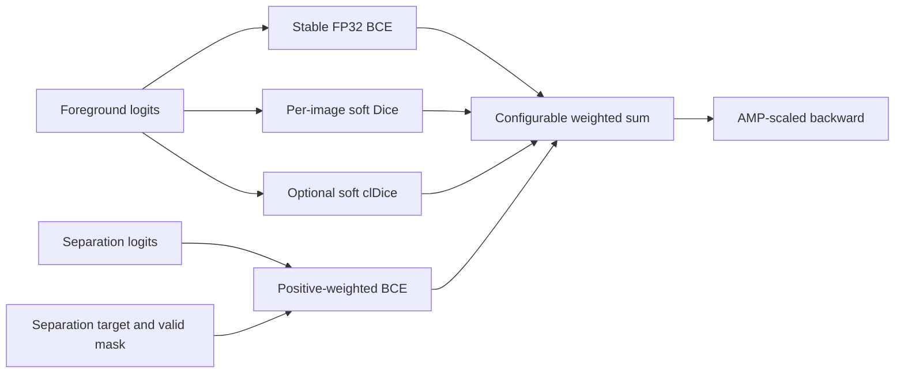

# Composite loss and overlap supervision

The model produces `[B,2,H,W]` logits. Channel 0 is foreground; channel 1 is
inter-instance separation. `FilamentPQProxyLoss` accepts three aligned `[B,1,H,W]`
maps: `foreground`, `separation`, `separation_valid`. Every sensitive calculation
explicitly disables autocast and casts logits/targets to FP32.

For foreground logits `z`, probability `p = sigmoid(z)` and union target `y`:

\[
L_{BCE}=-\operatorname{mean}[y\log p+(1-y)\log(1-p)],\quad
L_{Dice}=\operatorname{mean}_b\left[1-
\frac{2\sum p_b y_b+1}{\sum p_b+\sum y_b+1}\right].
\]

The implementation uses numerically stable BCE-with-logits rather than manually
taking logarithms. Dice is per image, then averaged, so its meaning remains
consistent as feasible microbatch size changes. Empty foreground images have
finite loss and still penalize false foreground.

For separation logits `s`, target `t`, exclusion mask `v`, positive weight `q`:

\[
L_{sep}=\operatorname{mean}_b
\frac{\sum_{h,w}v_b\,BCEWithLogits(s_b,t_b;pos\_weight=q)}
{\max(1,\sum_{h,w}v_b)}.
\]

The default `q=5` increases sparse positive separation gradients. It is not a
probability-calibration guarantee and should be tuned on validation. Per-image
valid-pixel reduction is necessary for exact sample-weighted accumulation when
overlap exclusions differ between images. An entirely excluded image contributes
zero separation gradient without dividing by zero.

The total is `0.35*BCE + 0.40*Dice + 0.25*separation + 0*clDice` by default.
All weights, `boundary_pos_weight`, and skeleton iterations are configurable.
Negative weights, nonpositive positive weight, and an all-zero objective are
rejected. The result dictionary contains differentiable `loss` and detached
`bce`, `dice`, `boundary`, `cldice` terms for logging. The historical `boundary`
name refers specifically to the separation term in the new pipeline.

## Why separation differs from exterior boundaries

The old `instance_boundaries` marked any ID transition, including foreground to
background. For a one-pixel-wide filament every foreground pixel could then be a
boundary; deleting such pixels at inference could erase the filament entirely.

The production target expands each independent mask in an 8-connected radius
neighborhood, counts how many distinct instances are nearby, and marks foreground
pixels near at least two instances. An isolated filament has no positive
separation labels, regardless of how thin it is. The radius is in native pixels.
Diagonal contacts are included to match 8-connected candidate extraction.

Overlapping annotation masks cannot be represented faithfully by one integer ID.
`build_instance_id_map` marks overlap as -1 and retains all source masks separately.
`build_boundary_target` excludes actual overlap and its radius neighborhood from
separation BCE because assigning a unique separating contour there is ambiguous.
Union foreground remains supervised. No instance is deleted, split or overwritten
in the stored evaluation ground truth.

For backward compatibility, the supplied loss still accepts `[B,H,W]` integer
IDs, deriving foreground from all nonzero IDs and excluding negative IDs from
separation. This legacy helper uses direct horizontal/vertical distinct-positive
contacts. Production training always passes independent-mask-derived maps.

## Optional topology term and extending the objective

The original `soft_erode`, `soft_open`, `soft_skeleton` and `soft_cldice_loss` are
reused. clDice measures soft skeleton precision/sensitivity against foreground,
encouraging thin-structure continuity. It does not encode instance identity and
can reward reconnection across distinct objects. Repeated full-resolution pooling
operations retain a substantial autograd graph; default weight is zero. Profile
the real composite loss before enabling it, and include it in VRAM probing.

To add a new term: implement a finite FP32 per-image objective, expose its weight
through `Config.loss`, add its detached name to `LOSS_NAMES`/plots, test empty and
overlap cases plus gradients, then rebuild the notebook. A loss must not require
collating every original instance mask into a large batch-level dense stack.
The architecture itself remains instance-friendly pixel prediction; none of these
losses directly differentiates the official hard threshold/matching operation.
