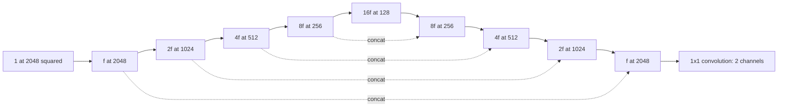
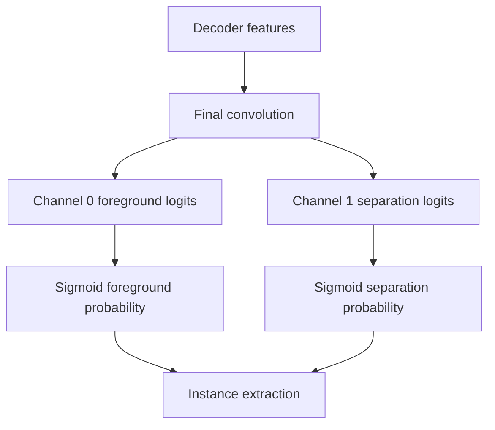

# Saved ModifiedUNet architecture

The default model is the user's saved U-Net, not a pretrained replacement. Each
`DoubleConv` contains two bias-free 3×3 convolutions, normalization and activation.
Max pooling reduces spatial dimensions; transpose convolution upsamples; decoder
features concatenate the matching encoder skip before another DoubleConv. A final
1×1 convolution emits raw logits.

| Stage | Shape for input `[B,1,2048,2048]` and width `f` |
|---|---|
| `inc` | `[B,f,2048,2048]` |
| `down1` | `[B,2f,1024,1024]` |
| `down2` | `[B,4f,512,512]` |
| `down3` | `[B,8f,256,256]` |
| `down4` | `[B,16f,128,128]` |
| `up1` + skip + `conv_up1` | `[B,8f,256,256]` |
| `up2` + skip + `conv_up2` | `[B,4f,512,512]` |
| `up3` + skip + `conv_up3` | `[B,2f,1024,1024]` |
| `up4` + skip + `conv_up4` | `[B,f,2048,2048]` |
| `outc` | `[B,2,2048,2048]` |

GroupNorm is the default for microbatch one. Group counts divide channel counts
and avoid one channel/group at a one-pixel bottleneck where practical. ReLU,
SiLU and leaky ReLU are configurable. BatchNorm works with checkpointing disabled;
the constructor rejects their combination because recomputation would update
running statistics twice. `none` normalization is also supported for experiments.

Checkpointing wraps complete encoder/decoder blocks, including transpose
convolution and concatenation, using `use_reentrant=False`. This reduces activation
storage at the cost of recomputation. It is active only during training with
gradients enabled. `_match_and_concat` pads the rounding difference for odd H/W;
even and odd shapes are tested. The four pools require H,W ≥ 16. Native dimensions
are already stride-compatible, so no production image padding is needed.

Change `Config.model['init_features']` to 8, 16 or 32 and rerun real-backward
probing. Width affects activation memory roughly linearly and parameter/optimizer
memory roughly quadratically. Never assume two T4s provide one shared 30-GB GPU.
All requested/effective settings are saved with checkpoints.

`build_model` provides one logits interface. For the optional original deeper
model, pass `name='full_image', in_channels=1, out_channels=2, base_channels=16,
depth=7, max_channels=256, checkpoint_blocks=True`. Its GroupNorm/global-context
components are retained in `filament/experimental.py`. Dynamic decoder alignment
was added. The shallow model's normalization/activation parameters do not apply
to this experimental constructor.

The raw `ModifiedUNet` constructor supports arbitrary positive output counts,
including a third experimental centerline head. The production configuration and
current loss/inference deliberately require exactly two channels. To train a third
head, add centerline supervision to the dataset, extend loss and inference channel
validation, then test those paths explicitly. Generating centerline targets alone
does not train a hidden third head.
