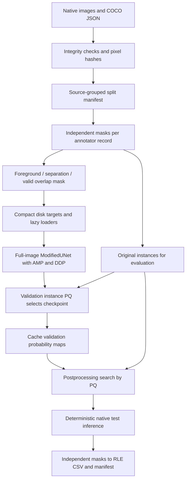
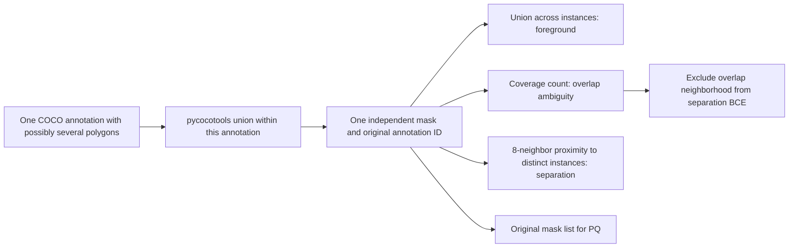

# Pipeline and data policy

The task requires one mask per filament. A correct foreground union alone cannot
tell whether two touching regions are distinct filaments or one object. This
pipeline retains the instance annotations through preparation, training targets,
validation and error analysis. Prediction still uses two pixel heads, so recovering
all overlapping identities is a modeling limitation, not an evaluation shortcut.

## Source audit and reuse

All requested sources were found. The exact filename
`solar-filament-u-net-full-image(1).ipynb` was absent; equivalent full-image sources
were located in the parent directory.

| Source | Findings and action |
|---|---|
| `unet.py` | Primary saved `ModifiedUNet`, `DoubleConv`, four max-pool stages, transpose convolutions, skips and `_match_and_concat` retained and made configurable. |
| `filament_pq_proxy_loss.py` | Reused soft erosion, opening, skeleton and clDice; refined proxy loss to accept explicit union/separation/valid maps and keep reductions FP32. |
| Parent `solar-filament-u-net-full-image.ipynb` | Reused discovery layout, source split policy, lazy caching, full-image forward, real Adam/backward probes, accumulation and independent worker orchestration. |
| Parent `solar-filament-u-net-full-image-ddp-strides-fixed.ipynb` | Inspected the revised DDP/full-image infrastructure. The new code uses the saved shallower U-Net by default, rather than substituting the deeper model. |
| `custom-Unet/solar-filament-u-net.ipynb` | Inspected; it uses tiles and union masks. Its foreground-based GT components are not suitable for instance PQ. It is left intact as historical input. |
| Parent `self-evaluation-notebook.ipynb` | Scoring reference. Selected functions are copied unchanged into `tests/reference_official.py` for direct parity checks. |
| `memo.md`, `task.md`, `download.svg` | Background references inspected; they do not supersede the pasted request. The SVG's encoder dimensions contain apparent typos, so dimensions are derived from actual pooling operations. |

The original `polygons_to_mask` union behavior is deliberately replaced by
`decode_annotation_mask`, `load_image_instances`, and explicit target builders.
OpenCV polygon rounding is replaced by pycocotools COCO rasterization. Foreground
union remains useful for one loss head, while original annotation membership is
retained for evaluation. The old foreground/background boundary target is replaced
by inter-instance proximity supervision. The old validation-loss checkpoint
selection is replaced by instance PQ. RLE helpers are adapted to strict round-trip
validation and resumable source accounting.

## Integrity and grouping

`make_records` reads only the training annotation JSON. It rejects duplicate image
or annotation IDs, unknown image references, crowd annotations without a policy,
missing files and dimension mismatches. Source images are decoded one at a time;
their grayscale pixel SHA-256 identifies identical data even when filenames/JPEG
metadata differ. `summarize_dataset` validates every polygon/RLE and reports area,
foreground, overlap and small-instance statistics. Invalid individual annotations
raise a useful exception; none are silently deleted. Annotation records with zero
instances remain valid.

The default split preserves prior policy: multiply annotated filenames remain in
training, validation uses eligible single-annotator sources. Each annotator record
is a separate training sample, preserving the prior extra weight on such sources.
All same-filename and same-pixel records are assigned together. Validation size
targets a fraction of unique filenames and can differ slightly when a duplicate
group must stay intact. The manifest is deterministic and reused. This prevents
exact source leakage, not temporal correlation between different observations.

IDs are 1-based annotation ordinals and `annotation_ids` maps them back to source
identities. The map uses -1 for overlap and cannot encode all identities there.
Compact original COCO annotations remain alongside each cache record. Evaluation
decodes these originals and ignores the ambiguous ID map entirely.

## Preprocessing and resources

Images remain 2048 × 2048 in every production forward pass. Unit normalization
maps uint8 to float32 / 255; robust percentile normalization is an explicit
alternative used consistently at all stages. Geometry uses flips/90° rotations,
so no interpolation damages fine structures. Photometric changes affect the image
only. Validation/test use no random transforms.

Targets are compressed NPZ files; no global dense image/mask stack is allocated.
Cache keys include annotation content, target algorithm version, shape, radius
and centerline option. Originals are compact JSON. Workers receive light records,
not large COCO payloads. Prediction masks are a lazy `InstanceMasks` sequence
backed by a label map; iterating materializes one binary instance at a time.

At 2048², one float32 map occupies 16 MiB. An input and three float targets occupy
about 64 MiB/sample before loader copies. Two float16 validation maps occupy
16 MiB/source; 200 sources need about 3.1 GiB. Keep one checkpoint-best prediction
namespace when disk is constrained, because different checkpoint hashes create
new namespaces. Checkpoint/cache/report directories are separate so artifacts can
be archived or removed deliberately.
