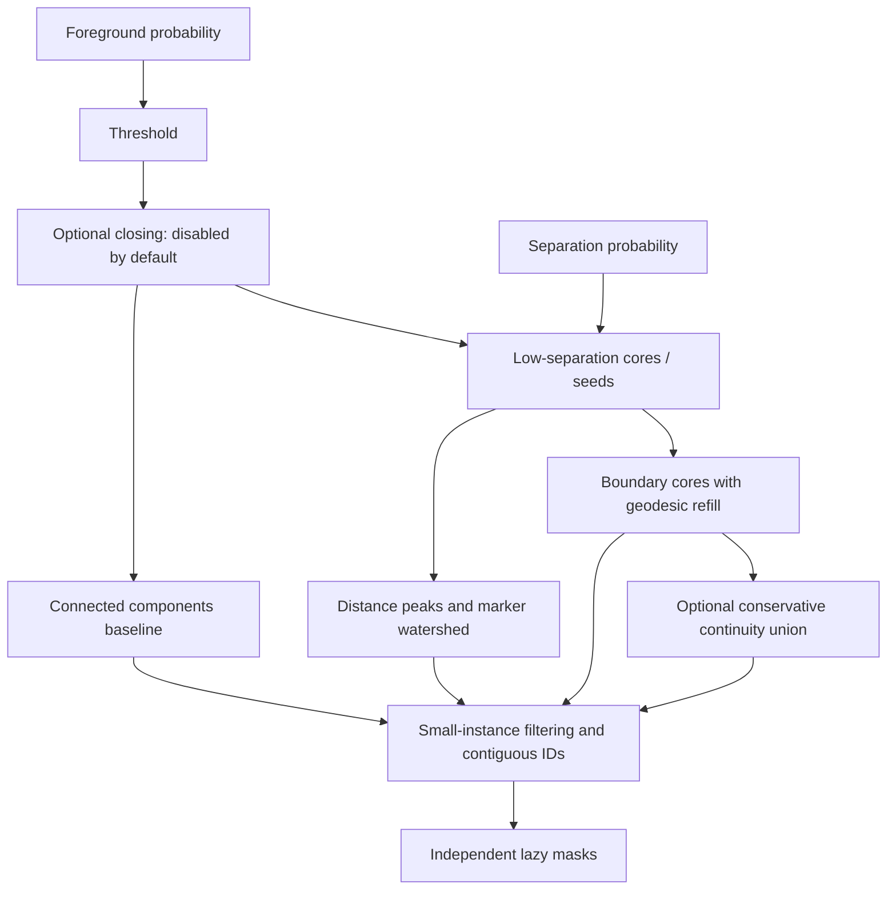

# Instance extraction and validation-only search

`extract_instances` accepts finite `[2,H,W]` probabilities in [0,1] and a
`PostprocessConfig` or dict. It returns an int32 HW label map and a lazy sequence
of independent full-resolution boolean masks. Background is zero and retained
instances have contiguous positive IDs. Unlike a dense list of thousands of
native masks, the sequence keeps one label map and materializes one mask at a
time. Calling `list(instances)` is possible but intentionally not needed by the
pipeline.

## Methods

**`components`** uses 8-connected foreground components. It is a useful comparison
baseline, not a claim that connected components equal filament identities. A
disconnected original annotation can be split, and touching objects can be merged.

**`boundary`** extracts connected cores from foreground below the separation
threshold, removes undersized seeds, and refills the *original foreground mask*
using marker-controlled geodesic flooding on a flat elevation. Separation pixels
are assigned to instances, not deleted. Each foreground component lacking seeds
receives a fallback marker over the whole component. This preserves all narrow
pixels even if an entire thin object is classified as separation, although a
fully ambiguous touching thin group can remain merged.

**`watershed`** computes foreground distance transform, picks local maxima inside
low-separation cores, and floods elevation `-distance + boundary_weight*separation`
within the foreground constraint. Seed spacing controls fragmentation. Fallback
markers again retain components with no eligible peak. Long elongated objects can
have many maxima, so this method must be compared by instance PQ rather than
assumed superior.

**`continuity`** starts from the boundary method and optionally unifies short-gap
fragments. Candidate fragments must be elongated by PCA (variance ratio ≥4), their
endpoints must be mutual nearest candidates, directions must align with the gap
(absolute cosine ≥0.95), and the straight gap must have foreground probability at
least 0.8 times the foreground threshold and separation below half its threshold.
Only IDs are joined; missing bridge pixels are not invented. This permits one
predicted instance to contain disconnected pieces. It can still join distinct
nearby filaments, so it is disabled by `reconnect_distance=0` and should only be
enabled after reviewing validation errors.

Small-object filtering follows extraction/refill. Morphological closing is
explicit and disabled by default; it can change topology and merge objects. It
unions the closed result with original foreground so original thin pixels do not
disappear. No exterior-boundary erosion is used as a default separation step.

## Parameters

| Parameter | Meaning / default |
|---|---|
| `method` | components, boundary (default), watershed, continuity |
| `foreground_threshold` | Foreground probability cutoff, 0.5 |
| `boundary_threshold` | Separation probability cutoff for safe cores, 0.5 |
| `min_area` | Minimum retained native instance pixels, 20 |
| `seed_min_area` | Minimum connected-core size, 3 (boundary methods) |
| `seed_distance` | Peak spacing, 5 native pixels (watershed) |
| `boundary_weight` | Separation contribution to watershed elevation, 2 |
| `closing_radius` | Binary closing iterations, 0 |
| `reconnect_distance` | Maximum short-gap length, 0 (continuity only) |

Thresholds must be strictly inside (0,1); areas/seed spacing must be positive and
morphology/weights nonnegative. Pixel thresholds are native units, not resized
image units.

## Search without retraining

`cache_validation_predictions` runs once per unique validation source and writes
two float16 maps atomically. The namespace binds checkpoint/preprocessing and
inference options, with source file hashes in each map filename. Search uses
memory mapping and processes one source at a time. Test extraction uses matching
float16 quantization, avoiding a hidden precision change between tuning and test.

`search_postprocessing` enumerates the supplied grid over a base configuration,
evaluates every annotator record with original masks and ranks primarily by global
PQ. It also reports TP/FP/FN, matched IoU, positive-pair Dice/IoU means,
fragmentation/overmerging, instance counts and runtime. Ties keep the first grid
configuration deterministically. Results go to `postprocessing_trials.csv`,
`postprocessing_comparison.png`, `best_validation_details.json`, and
`best_postprocessing.json` containing provenance and validation IDs.

The notebook grid includes methods, foreground/separation thresholds and minimum
area; seed spacing, seed size, elevation weight and morphology can be added as
grid keys. Start small on a one-core host: every trial reruns CPU extraction and
RLE matching, even though it avoids GPU inference. Do not select settings using
test annotations or leaderboard feedback.

To add an algorithm, implement `(foreground_bool, separation_probability, cfg)`
returning labels, register it in the method dispatch and config validation, add
its parameters to the dataclass, then test empty, narrow, touching and fragmented
synthetic objects. New algorithms must not reinterpret ground truth or change
the official evaluator.
