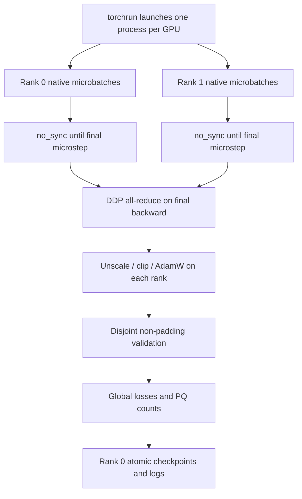

# Training, memory and recovery

Training uses whole native images on one CUDA GPU or Linux/NCCL DDP. The notebook
exports a runtime package and starts `python -m filament.cli worker`; two GPUs
launch the same module with `torch.distributed.run`. The parent notebook keeps no
GPU model while training, avoiding accidental competition for VRAM. Native CPU
unit tests are supported by the lower-level engine; the production entry point
requires CUDA.

## Memory probing and fallback

`probe_batch_sizes` measures real training with one preprocessed dataset sample
repeated to the candidate batch size. It runs the configured architecture, AMP,
FP32 composite loss, two accumulated backward microsteps where configured, gradient
unscale/clipping and two AdamW updates. The second update includes optimizer slots
already allocated by the first. Peak allocated/reserved memory, current memory,
free/total VRAM, elapsed probe time and optimizer allocation are recorded.

Weights and random streams are saved/restored around probing. Each rank probes an
unwrapped model, catches local CUDA OOM, releases intermediates and only then
participates in report gathering. A candidate must fit every rank within the
configured `memory_fraction` and leave at least 384 MiB or twice parameter bytes
for additional DDP/NCCL state. Auto mode chooses the largest common feasible
candidate; explicit requested batches fall back to one if necessary.

ModifiedUNet defaults to width 16, activation checkpointing and GroupNorm. If no
batch fits before training, configured smaller widths are tried. If training
later OOMs, the worker records an OOM marker and fails; torchrun tears down peers,
and the parent replays the interrupted epoch from `last.pt` at a smaller batch.
It never attempts a rank-local batch change inside a collective. A saved
architecture is never silently resized to resume. At microbatch one with a saved
checkpoint, unrecoverable memory failure stops with an actionable error.

Resolution is always 2048². A memory probe is evidence about the measured GPU and
path, not a guarantee against all future allocator pressure or another process.
The default disabled clDice must be reprofiled when enabled.

## AMP and optimizer updates

The forward pass uses FP16 autocast on CUDA; the loss disables autocast and reduces
in FP32. GradScaler scales backward, gradients are unscaled once per optimizer
window, clipped, and AdamW steps through the scaler. No optimizer, clipping,
scaler update or scheduler update occurs inside validation. Scheduler steps once
per epoch after validation (plateau uses validation loss). Model selection and
early stopping use PQ, independently of this learning-rate diagnostic.

For microbatch sizes `n_i` in one accumulation window, the backward scale is
`n_i / sum(n_i)`. Both an incomplete final window and a smaller final batch are
handled using the actual sampler length. DDP ranks have equal training sampler
lengths, so averaging their gradients has the intended sample weighting. This is
the average of per-image Dice losses, not a single global Dice over the effective
batch. The scalar-engine test compares short-window updates against a direct
reference, and the two-rank Gloo smoke repeats this comparison under DDP.



## Loaders, CPU and reproducibility

`workers` is a total budget split across ranks, not workers per GPU. The default
is four: two spawned loader processes per GPU on a dual-T4 host. Workers use one
native-library thread and prefetch two batches each. A shared phase flag and
phase sampler reuse one persistent pool across training and validation, avoiding
eight loader workers. `workers=0` selects serial loading for debugging.
Pinning is enabled for CUDA. Training uses a DistributedSampler with
`set_epoch`; its padding can repeat a few records to give equal rank lengths.
Validation uses disjoint indices without repetition, can leave a rank with zero
batches, and forwards through the unwrapped module to avoid unequal collective
counts. Metric reduction happens after all local batches finish.

Preparation/indexing, target caching and statistics use a bounded four-thread
pool. Identical target fingerprints share a locked write; per-record annotation
metadata stays separate. The notebook reuses its initial dataset index instead
of decoding all source images again during preparation. Postprocessing search
parallelizes trials without nested source pools and retains first-trial tie
handling. Matplotlib output and artifact assembly stay on the calling thread.

After training, `MultiDevicePredictor` uses an exclusive queue slot per model/GPU.
Four CPU jobs overlap reading, forwarding on two GPUs, CPU instance extraction,
and RLE encoding. Each GPU processes one complete image at a time. No model is
forwarded concurrently by two threads. Ordered, bounded results keep memory use
proportional to workers, preserve CSV order and retain resumable atomic journals.

Notebook defaults enable cuDNN autotuning (`deterministic=False`) and probe
microbatches 1, 2 and 4 under the existing 85% per-device memory limit. FP16,
channels-last and activation checkpointing remain enabled. Set
`cfg.deterministic=True` before preparation to resume an older deterministic run;
resume deliberately rejects changes to that setting. Full GPU utilization and
throughput depend on the data and selected model; measure epoch seconds and
images/second in `logs/history.csv` and per-rank hardware in `runtime_report.json`.

Augmentation RNG depends on seed, epoch and item index, and shared epoch state
reaches persistent workers. Loader sampling generators are seeded per epoch/rank.
Python, NumPy, Torch and rank-local CUDA RNG states are stored in checkpoints.
Deterministic algorithms use `warn_only=True`; warnings identify operations that
cannot guarantee bit-identical CUDA results. The launcher sets
`CUBLAS_WORKSPACE_CONFIG=:4096:8`. Resume preserves mathematical state at a complete
epoch; changed world size is rejected. Changing the microbatch during OOM recovery
can change optimization/rounding trajectories despite correct accumulation.

## Checkpoints, selection and logs

`best.pt` is updated only when global instance PQ strictly improves; `last.pt`
stores the last completed epoch. Both contain model, optimizer, scheduler, scaler,
epoch, best metrics, configuration, history, early-stopping state, split/content
fingerprint and all rank RNG states. Atomic rename prevents a partially written
checkpoint from replacing a good one. Checkpoints use trusted Python serialization
and must only be loaded from a trusted source.

`pq_every` controls instance evaluation frequency; the final epoch always receives
PQ. Patience counts PQ evaluations without improvement rather than all epochs.
All epochs still compute validation loss. Set `resume` to the last checkpoint
path in configuration; preparation and training reject inconsistent dataset
membership, annotation content, loss, normalization, augmentation, accumulation,
separation radius, scheduler, seed/determinism, AMP, optimizer settings, clipping
or world size. Effective architecture is loaded from
the checkpoint. Optimizer/scheduler/scaler state is restored before continuing.

CSV history records each loss component, learning rate, train/validation duration,
images/second, total elapsed training time and max rank GPU memory. GPU utilization
is an optional point sample where NVML is installed, otherwise null. Runtime JSON
records hardware, package versions, CUDA/PyTorch and every memory-probe result.

## Practical budget

Validation caches need 16 MiB/source for two float16 maps, plus one ID map and one
materialized predicted instance at a time. Cached targets compress well for sparse
filaments. Disk use grows with the number of prediction namespaces and experiments;
archive or remove obsolete runs intentionally. Defaults keep two checkpoints per
experiment and do not save all per-epoch model states. Training throughput on one
CPU core and dual T4 must be measured on Kaggle; increasing workers can slow it
down if CPU decoding is oversubscribed.

Useful commands (run from `custom-Unet`):

```bash
python -m pytest -q
python tests/ddp_smoke_worker.py
python -m filament.cli smoke --gpus 1 --output validation_runs/local_smoke
```

Optional native probe test in PowerShell:

```powershell
$env:FILAMENT_NATIVE_SMOKE = '1'
python -m pytest -q -m native
```

The full CLI smoke already performs native forward/backward/AdamW, validation,
checkpoints and logs. The opt-in test separately validates the probe contract.
