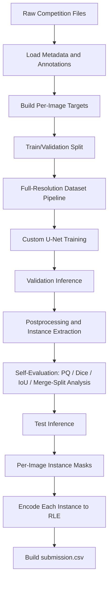
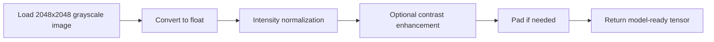
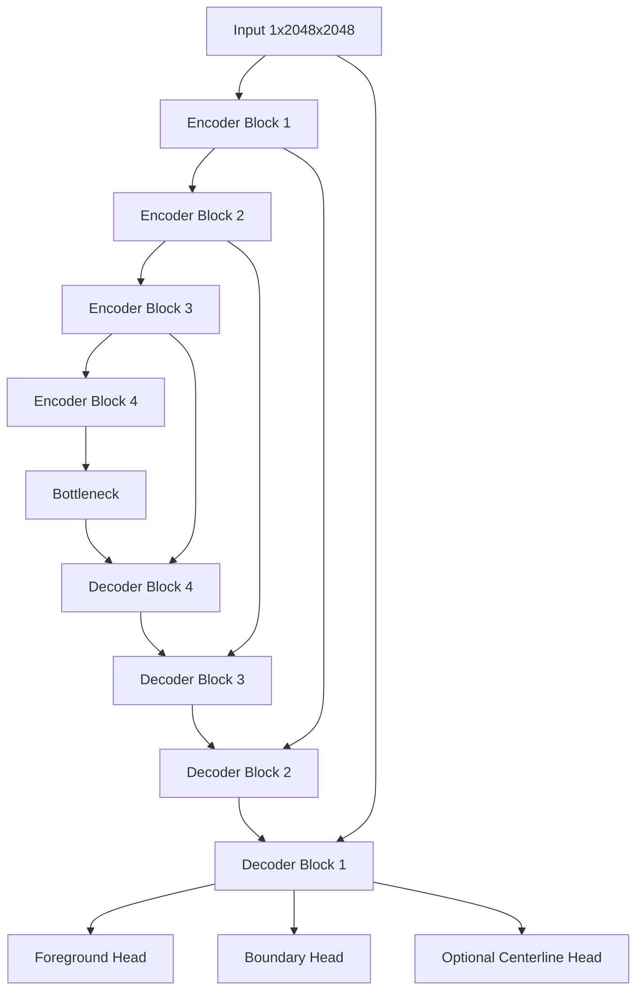
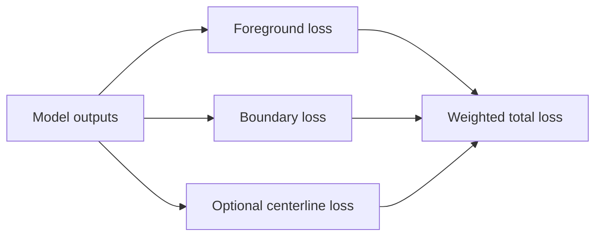
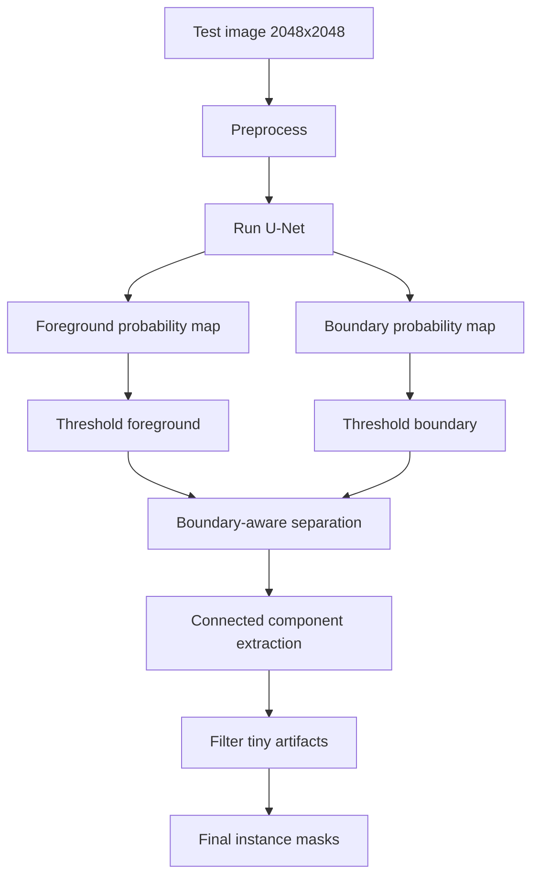
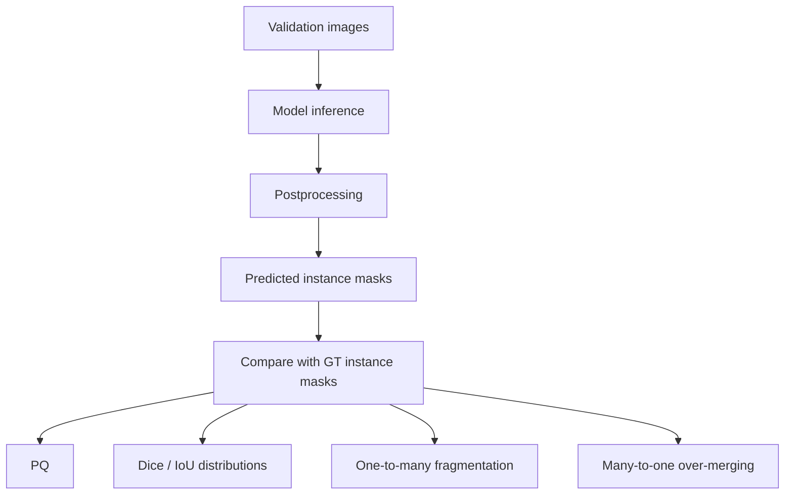
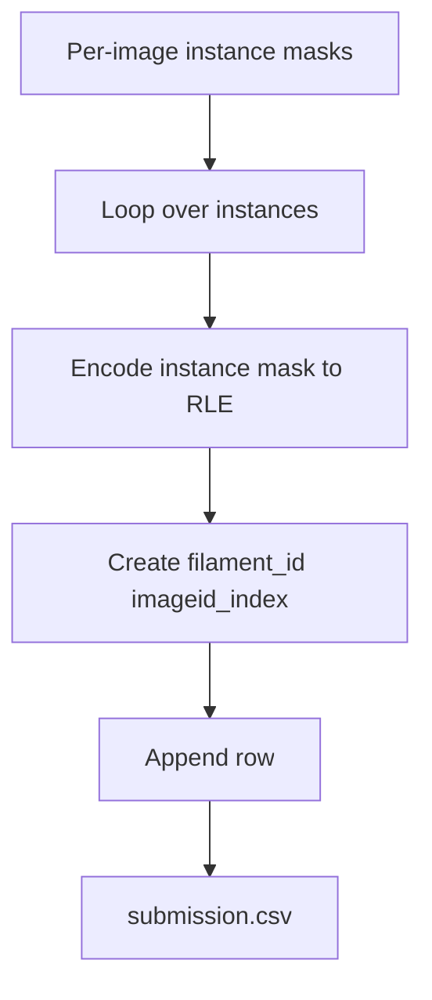

# Full pipeline for Solar Filament Segmentation 2026  
## Goal
Build a **full-resolution custom U-Net pipeline** that:

- uses **2048 × 2048 images**
- preserves fine filament structures
- predicts masks that can be converted into **individual filament instances**
- outputs the final Kaggle submission format:
  - `filament_id`
  - `segmentation_rle`【turn780072search0】

---

# 1. Competition-grounded design requirements

From the Kaggle page:

- The task is **automated segmentation of solar filaments** from **GONG H-alpha observations**【turn454619search0】.
- The current primary metric is **Panoptic Quality (PQ)**, not just Dice【turn454619search0】.
- Evaluation also considers **Dice distribution, IoU distribution, one-to-many and many-to-one relations**【turn454619search0】.
- The output must be a **single CSV** with one row per predicted filament, and each row stores **RLE counts** for a 2048×2048 mask【turn780072search0】.

### What this means for model design

A good pipeline must optimize for:

1. **Pixel accuracy**  
   so the filament shape is correct.

2. **Structural continuity**  
   so long filaments are not fragmented.

3. **Instance separation**  
   so touching filaments are not merged.

So your U-Net should be used as an **instance-friendly segmentation model**, not only as a binary foreground model.

---

# 2. Recommended overall strategy

## Recommended output design for the custom U-Net

Use a **multi-head full-resolution U-Net**:

- **Head A: Foreground mask**
  - predicts filament vs background

- **Head B: Boundary / separation map**
  - predicts borders between adjacent filaments

- **Optional Head C: Centerline / confidence map**
  - helps preserve thin filament continuity

This is still a **custom U-Net**, but it is much better aligned with PQ than a single-output binary mask.

---

# 3. End-to-end pipeline diagram



---

# 4. Data pipeline details

## 4.1 Input files

Conceptually, your raw inputs are:

- training images
- training annotations
- test images

The masks in this competition are instance-level, because submission is one row per filament and evaluation matches predicted and true segments based on overlap【turn780072search0】.

---

## 4.2 Data preparation goals

For each training image, you should generate:

1. **Image tensor**
2. **Binary foreground mask**
3. **Instance ID map**
4. **Boundary target**
5. **Optional centerline target**
6. **Metadata**
   - image id
   - original size
   - number of instances
   - file path

---

# 5. Data-preparation module structure

Below is the clean modular structure.

---

## Module A — dataset indexing

### `discover_dataset_files()`
**Purpose:**  
Locate train/test images, annotation files, and build file lists.

**Input:**  
dataset root

**Output:**  
paths to:
- train image directory
- test image directory
- annotation file(s)
- image file list

---

### `load_annotation_json()`
**Purpose:**  
Read the COCO-style annotation JSON.

**Input:**  
annotation file path

**Output:**  
parsed annotation object

---

### `build_image_annotation_index()`
**Purpose:**  
Create a mapping:

- image_id → image metadata
- image_id → list of annotation objects

**Input:**  
parsed COCO annotations

**Output:**  
indexed lookup tables

---

## Module B — target construction

### `decode_instance_masks_for_image(image_id)`
**Purpose:**  
Convert all annotations for one image into per-instance masks.

**Input:**  
`image_id`, annotation index

**Output:**  
list of binary masks, one per filament instance

---

### `build_instance_id_map(instance_masks)`
**Purpose:**  
Assign each filament a unique integer ID in a single map.

**Input:**  
list of instance masks

**Output:**  
`instance_id_map`  
- 0 = background  
- 1..N = filament instances

---

### `build_binary_mask(instance_id_map)`
**Purpose:**  
Collapse all filament pixels into a single foreground mask.

**Input:**  
instance ID map

**Output:**  
binary mask

---

### `build_boundary_target(instance_id_map)`
**Purpose:**  
Generate a supervision target that marks boundaries between touching or nearby filament instances.

**Input:**  
instance ID map

**Output:**  
binary or soft boundary map

**Why important:**  
Helps reduce **over-merging**, which matters for PQ.

---

### `build_centerline_target(instance_id_map)` *(optional)*
**Purpose:**  
Generate a filament skeleton/centerline target.

**Input:**  
instance ID map

**Output:**  
centerline mask

**Why important:**  
Helps preserve thin structures and reduce fragmentation.

---

## Module C — statistics and checks

### `summarize_dataset_statistics()`
**Purpose:**  
Compute useful dataset stats.

**Examples:**
- number of images
- number of filaments per image
- filament area distribution
- small vs large object counts
- empty image count if any

**Why important:**  
Needed for training decisions and report writing.

---

### `validate_target_integrity()`
**Purpose:**  
Catch annotation conversion errors.

**Checks:**
- no overlapping instance IDs in one pixel
- binary mask matches union of instances
- boundary map only appears near object edges
- mask dimensions equal original image dimensions

---

# 6. Train/validation split design

Because leakage can happen if you split carelessly, do the split at the **image level**, not at the instance level.

## Recommended split

### `make_train_val_split()`
**Purpose:**  
Split full images into train and validation sets.

**Input:**  
list of image IDs, optional random seed

**Output:**  
train image IDs, validation image IDs

### Optional improvement
Use a **stratified image-level split** based on:
- number of filaments in image
- total filament area
- complexity score

This helps validation better reflect test behavior.

---

# 7. Preprocessing pipeline

Since you want **full resolution**, avoid resizing down to 512 or 1024 for the main model.

## Recommended preprocessing order



---

## Core preprocessing functions

### `load_grayscale_image(image_path)`
**Purpose:**  
Read the H-alpha image as a single-channel array.

---

### `normalize_intensity(image)`
**Purpose:**  
Normalize image intensity consistently.

**Recommended options:**
- percentile clipping + min-max scaling
- z-score normalization
- robust normalization using median/IQR

**Recommendation:**  
Start with **percentile clipping + min-max** because H-alpha images can have brightness variation.

---

### `optional_contrast_enhancement(image)`
**Purpose:**  
Improve local filament visibility.

**Examples:**
- CLAHE
- unsharp masking
- local contrast normalization

**Important:**  
This should be tested carefully.  
It may help filament contrast, but aggressive enhancement can increase false positives.

---

### `pad_to_model_stride(image, targets, stride=16 or 32)`
**Purpose:**  
Ensure dimensions are divisible by the encoder/decoder stride.

**Why:**  
Even though images are usually 2048×2048, padding logic makes the pipeline robust.

---

# 8. Augmentation pipeline

Because morphology matters, augmentations should preserve shape realism.

## Recommended augmentations

### Safe spatial augmentations
- horizontal flip
- vertical flip
- 90° rotations
- small translations
- mild scaling
- mild elastic deformation only if carefully tested

### Safe intensity augmentations
- brightness shift
- contrast shift
- gamma adjustment
- mild noise

### Avoid
- heavy blur
- aggressive cropping that cuts filaments
- strong elastic deformations
- severe resolution loss

---

## Function structure

### `apply_spatial_augmentations(image, targets)`
### `apply_intensity_augmentations(image)`
### `compose_training_sample(image, binary_mask, instance_map, boundary_map, centerline_map)`

---

# 9. Model architecture pipeline

## Recommended custom U-Net

Use a **full-resolution custom U-Net** with these characteristics:

### Input
- 1 channel grayscale image  
- shape: `1 × 2048 × 2048`

### Encoder
- 4 or 5 downsampling stages
- residual double conv blocks preferred
- GroupNorm or BatchNorm
- ReLU / LeakyReLU / SiLU

### Bottleneck
- wider feature representation
- optional dilated convolutions

### Decoder
- upsampling + skip connections
- boundary-aware reconstruction

### Output heads
- **foreground head**: 1 channel
- **boundary head**: 1 channel
- **optional centerline head**: 1 channel

---

## Architecture diagram



---

# 10. Training targets and losses

Since the competition metric is PQ, your loss should be a **proxy** for:

- good overlap
- good separation
- good continuity

## Recommended supervision targets
- foreground mask
- boundary map
- optional centerline map

## Recommended training objective
Use a weighted combination of:

1. **foreground BCE / focal-like term**
2. **foreground Dice term**
3. **boundary BCE term**
4. **optional clDice / topology term**

---

## Training-loss design diagram



---

# 11. Full-resolution training strategy

Because you want to preserve fine filament information, train at **native 2048×2048 resolution**.

## Practical constraints
Full-resolution U-Net training is expensive.

## Recommended training strategy

### `configure_training_runtime()`
Set:
- AMP / mixed precision
- gradient accumulation
- gradient clipping
- checkpoint saving
- deterministic seed
- worker configuration

### `estimate_memory_budget()`
Before real training:
- run a dry pass
- find max batch size per GPU

### `train_one_epoch()`
Per epoch:
- load batch
- forward
- compute weighted losses
- backward
- optimizer step
- scheduler step if needed

### `validate_one_epoch()`
Per validation epoch:
- forward only
- postprocess outputs
- compute validation metrics

---

## Full-resolution training notes

I recommend:

- **batch size 1 or 2**
- **AMP**
- **gradient accumulation**
- **gradient checkpointing** if needed
- keep augmentations efficient
- avoid any unnecessary resizing

If memory becomes impossible, prefer:
1. simplifying channels,
2. checkpointing,
3. accumulation,
before resorting to smaller image sizes.

---

# 12. Inference pipeline

Training predicts dense maps.  
Inference must convert them into **instance masks**.

## Inference diagram



---

## Inference functions

### `predict_raw_maps(image)`
**Output:**
- foreground probability map
- boundary probability map
- optional centerline map

---

### `threshold_foreground(prob_map)`
**Purpose:**  
Convert foreground probabilities into a binary candidate mask.

---

### `threshold_boundary(boundary_map)`
**Purpose:**  
Extract boundaries to help separate adjacent filaments.

---

### `separate_instances(foreground_mask, boundary_mask, centerline_map=None)`
**Purpose:**  
Convert dense outputs into individual instance regions.

## Recommended approaches
Choose one main approach:

### Option A — boundary subtraction + connected components
- subtract boundary pixels from foreground
- run connected components

### Option B — watershed using boundary or distance seeds
- distance/centerline based seeds
- watershed inside foreground region

### Option C — centerline-guided splitting
- useful for long thin filaments

**Recommendation:**  
Start with **boundary subtraction + connected components**, then test watershed if over-merging remains high.

---

### `remove_small_artifacts(instance_masks)`
**Purpose:**  
Remove tiny false positives.

**Input:**  
list or labeled map of instances

**Output:**  
cleaned instance masks

**Tip:**  
Set thresholds carefully so you do not delete true tiny filaments.

---

### `restore_original_geometry(instance_masks)`
**Purpose:**  
Remove padding and ensure masks are exactly 2048×2048.

---

# 13. Validation and self-evaluation pipeline

The competition page provides a self-evaluation notebook, and Kaggle says participants should use it to better understand model effectiveness【turn454619search0】.

Your validation pipeline should mimic final evaluation as closely as possible.

## Validation metrics to compute
- Panoptic Quality (main)
- Dice distribution
- IoU distribution
- one-to-many fragmentation
- many-to-one over-merging
- number of predicted instances
- average area of predicted instances

---

## Validation diagram



---

## Validation functions

### `run_validation_inference()`
Generate predictions for all validation images.

### `evaluate_instance_predictions()`
Compute PQ and instance-level matches.

### `analyze_fragmentation_and_merging()`
Produce statistics for:
- one GT → many predictions
- many GT → one prediction

### `select_best_thresholds()`
Tune:
- foreground threshold
- boundary threshold
- minimum area threshold

**Important:**  
Do not tune only for Dice.  
Tune for **PQ first**, then check fragmentation and over-merging.

---

# 14. Test-time inference pipeline

After thresholds and postprocessing are chosen:

### `run_test_inference()`
For each test image:
1. load image
2. preprocess
3. predict maps
4. separate instances
5. clean instances
6. export list of final masks

---

# 15. Submission generation

Kaggle requires one CSV row per predicted filament, with RLE counts and a unique `filament_id` derived from the image ID【turn780072search0】.

## Submission diagram



---

## Submission functions

### `enumerate_instances_for_image(image_id, instance_masks)`
**Purpose:**  
Assign unique row names:
- `imageid_1`
- `imageid_2`
- `imageid_3`

---

### `encode_instance_mask_to_rle(mask)`
**Purpose:**  
Convert a 2048×2048 binary instance mask into RLE counts.

**Requirement from Kaggle:**  
Only the **RLE counts** are stored; size is fixed at **2048 × 2048**【turn780072search0】.

---

### `build_submission_rows(image_id, instance_masks)`
**Purpose:**  
Create one CSV row per filament.

---

### `write_submission_csv(rows)`
**Purpose:**  
Save the final file with exactly:
- `filament_id`
- `segmentation_rle`

---

# 16. Final recommended project structure

Here is the clean logical structure.

```text
project/
│
├── config/
│   ├── dataset_config
│   ├── model_config
│   ├── training_config
│   └── inference_config
│
├── data/
│   ├── indexing
│   ├── annotation_parsing
│   ├── target_building
│   ├── preprocessing
│   ├── augmentation
│   └── dataset_objects
│
├── model/
│   ├── custom_unet_backbone
│   ├── encoder_blocks
│   ├── decoder_blocks
│   ├── output_heads
│   └── loss_definitions
│
├── training/
│   ├── trainer
│   ├── validation_runner
│   ├── checkpointing
│   └── logging
│
├── inference/
│   ├── predictor
│   ├── thresholding
│   ├── instance_separation
│   ├── artifact_filtering
│   └── geometry_restore
│
├── evaluation/
│   ├── pq_evaluation
│   ├── dice_iou_analysis
│   ├── fragmentation_analysis
│   └── visualization
│
└── submission/
    ├── rle_encoding
    ├── row_builder
    └── csv_writer
```

---

# 17. Recommended exact pipeline for your case

If I were designing **your first strong baseline**, I would use this exact plan:

## Baseline A — strong custom U-Net baseline
- **Input:** full-resolution 2048×2048 grayscale image
- **Model:** custom U-Net
- **Outputs:** foreground + boundary
- **Loss:** BCE + Dice + boundary loss
- **Inference:** threshold foreground, subtract boundaries, connected components
- **Postprocess:** remove tiny objects, optional hole filling
- **Validation target:** maximize **PQ**
- **Submission:** one RLE row per final instance

This is the best balance of:
- full-resolution detail preservation
- manageable complexity
- alignment with PQ
- compatibility with your existing U-Net direction

---

# 18. What not to do

For this competition, avoid these mistakes:

1. **Only train a binary foreground model and stop there**  
   → likely over-merges touching filaments.

2. **Resize down too aggressively**  
   → small structures and fine barbs are lost.

3. **Tune only for Dice**  
   → may look good on overlap but still perform worse on PQ.

4. **Use postprocessing that merges nearby objects too aggressively**  
   → hurts many-to-one behavior.

5. **Remove small components too aggressively**  
   → hurts recall and may fragment long filaments.

---

# 19. Best-practice summary

## The best full pipeline is:

**COCO annotations → per-image instance targets → full-resolution preprocessing → multi-head custom U-Net → foreground/boundary prediction → instance separation → validation with PQ → RLE encoding → Kaggle CSV**

That design is the most faithful to the competition, because Kaggle explicitly emphasizes:
- **individual filament segmentation**
- **Panoptic Quality**
- **fragmentation / over-merging analysis**
- and **per-filament RLE submission rows**【turn454619search0】【turn780072search0】.

---

If you want, next I can turn this into either:

1. **a notebook-style section outline**  
   (like headings/subheadings for your Kaggle notebook),

or

2. **a step-by-step implementation checklist**  
   (very detailed, ordered, like “first build this function, then this one, then this one”).